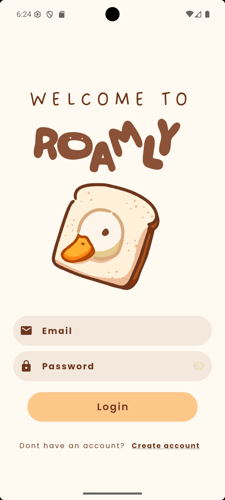
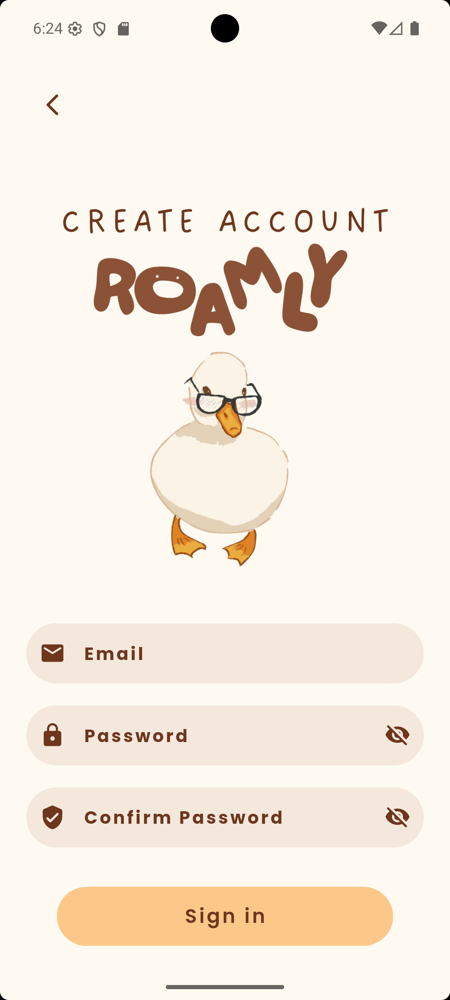
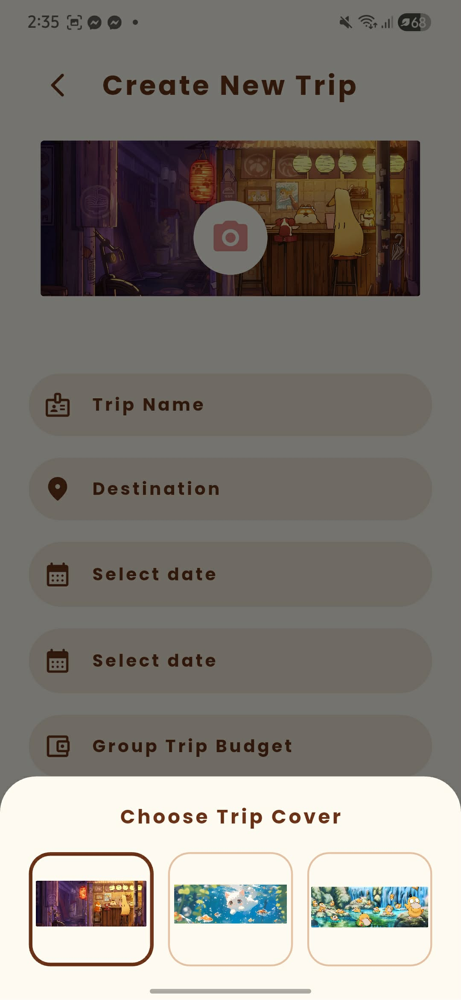

# Roamly

**Plan your next trip and keep your travel budget in view.**

Roamly is a mobile travel planning and budget tracking app developed in **Android Studio with Flutter and Dart**. It brings trip details, personal and group budgets, expenses, and itineraries together so travelers can organize an adventure and keep track of its costs in one place.

## Key features

| Feature | What it does |
| --- | --- |
| **Home dashboard** | View planned trip totals, group budgets, personal spending, and recent trips, with quick access to trip creation. |
| **Trip management** | Create, edit, and delete trips with a name, destination, start and end dates, member count, notes, and a choice of illustrated covers. |
| **Personal and group budgets** | Set separate budgets for each trip and review group expense totals, estimated shares per member, and the remaining personal budget. Amounts are displayed in Philippine pesos (PHP). |
| **Expense tracking** | Add, edit, and delete personal or group expenses with an amount, date, and notes. Organize spending into Food, Transport, Stay, and Other categories. |
| **Itinerary planning** | Create, update, and remove activities with a title, location, date, time, and notes. View plans organized by date within each trip. |
| **Account access** | Register, sign in, view the traveler profile, and sign out through Firebase Authentication. |
| **Live data updates** | Trips, expenses, and itinerary records are stored in Cloud Firestore and displayed through live data streams for the signed-in user. |

## How the app fits together

1. **Create a trip** with its destination, dates, member count, and budgets.
2. **Plan the itinerary** by adding activities and places to visit.
3. **Record spending** as personal or group expenses.
4. **Review the budget** to see personal spending, remaining funds, and estimated group shares.

The main navigation connects **Home**, **Trips**, and **Profile**. Each trip opens a details page with access to its **Budget** and **Itinerary**.

## App preview

Roamly uses warm colors, rounded cards, custom typography, and travel-themed illustrations.

<table>
  <tr>
    <th>Sign in</th>
    <th>Create an account</th>
    <th>Trip cover selection</th>
  </tr>
  <tr>
    <td align="center"></td>
    <td align="center"></td>
    <td align="center"></td>
  </tr>
</table>

## Built with

| Technology | Role |
| --- | --- |
| **Flutter and Dart** | Mobile interface and application logic |
| **Firebase Authentication** | Account registration, sign-in, and sign-out |
| **Cloud Firestore** | Trip, expense, and itinerary data |
| **Provider** | Application state management |
| **Android Studio** | Development environment |
